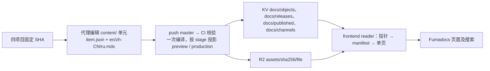

# 文档架构

由 AI 代理读取四个项目的固定代码版本并维护 docs 正文。英文为主，中文和俄文为翻译。Git 保存权威正文（内容单元），CI 编译成内容寻址对象与每频道一份 manifest，JSON 写入 Workers KV、二进制资源写入 R2，frontend 按频道读取并保留 Fumadocs 文档页面。

| 层 | 职责 |
| --- | --- |
| 业务项目 | 已核对的代码事实，不执行跨仓文档自动合并 |
| docs | 单元、导航、翻译、资源、基线、Fumadocs/Shiki 编译、按频道投影、发布与回滚 |
| KV `cscheap-content` | 不可变内容对象与 manifest、激活标记、每频道一个 current/previous 指针 |
| R2 `cscheap-content` | 不可变资源 |
| frontend | 按环境选频道；请求范围内一致的路由、正文、导航、搜索、SEO 和缓存 |

保留 `/{locale}/docs/...`，介绍页规范地址为 `/{locale}/docs`。法律页、博客、白皮书和产品 changelog 继续使用现有内容来源；sites / blog 日后按同一单元形状与存储模型接入，使用各自的键前缀。

正文树（受限 hast、编译期代码高亮、structuredData）与 v2 相同，是一份可校验的纯数据。v3 改变的是容器：不再有整包，前端一次请求只读指针、manifest 和当前一页，运行时只核对象 sha256 与顶层字段，不深校验正文。

普通文字、导航、译文和已有组件参数变更无需重新构建 frontend。新增组件、改变属性契约需要先部署应用。

- [首版范围](v1-scope.md)
- [仓库目录](repository-layout.md)
- [用户目录](information-architecture.md)
- [内容契约 v3](content-contract.md)
- [编辑流程](editing.md)
- [内容发布](publishing.md)
- [发布操作](release-operations.md)
- [内容契约 v3 决策](../decisions/0006-content-contract-v3.md)

93 个单元、279 页正文及其业务 SHA 基线从 v2 无损迁入（源提交 `f11a521a0dcd32636ad04495414f207f38657451`，全部 `stage: published`）。frontend 读取端切到 v3 是独立任务；历史验证报告保留原时间点事实。
